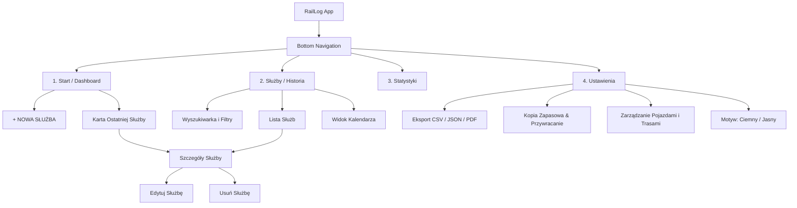

# RAILLOG — PRODUCT & UX SPECIFICATION
## Dziennik Służb Maszynisty (Android)
**Wersja:** 1.0.0-DRAFT  
**Rola:** Senior Product Designer / Senior UX Designer / Senior Android Architect  
**Data:** Październik 2026  
**Status:** Gotowy do weryfikacji i akceptacji  

---

## 1. WIZJA PRODUKTU I DEFINICJA BIZNESOWA

### 1.1. Misja
Stworzenie najbardziej intuicyjnego, eleganckiego i niezawodnego prywatnego dziennika służb dla maszynistów kolejowych w Polsce. Aplikacja **RailLog** eliminuje papierowe notesy i chaotyczne arkusze kalkulacyjne, dając maszyniście poczucie kontroli nad własnym czasem pracy, historią przejazdów i wypracowanymi nadgodzinami.

### 1.2. Problem rzeczywisty
Maszynista po 8–12 godzinach dyżuru (często w nocy, w trudnych warunkach pogodowych, zmęczony) musi zanotować kluczowe fakty ze swojej służby do prywatnego archiwum:
- Na czym jechał (seria i numer pojazdu),
- Z czym jechał (numery pociągów),
- Na jakiej relacji (stacja początkowa, pośrednia, końcowa),
- Ile wygenerował nadgodzin,
- Co nietypowego wydarzyło się na szlaku (usterka, radiołączność, opóźnienie, zmiana loka).

Obecne rozwiązania to:
- Papierowy notesik (łatwo zgubić, brak statystyk, brak wyszukiwania),
- Excel w telefonie (niewygodny na małym ekranie, wymaga dwóch rąk, frustrujący),
- Korporacyjne systemy przewoźników (niedostępne prywatnie, powolne, skomplikowane).

### 1.3. Filozofia „Zero Friction” (Złota Zasada 20–30 sekund)
RailLog **nie jest systemem rozliczeniowym korporacji**. To prywatny notes maszynisty. 
1. **Jedna dana obowiązkowa:** Data (domyślnie ustawiona na *dzisiaj*).
2. **Pełna opcjonalność:** Każde inne pole może pozostać puste.
3. **Inteligentna pamięć:** Aplikacja uczy się zwyczajów maszynisty (najczęstsze serie, ostatnie relacje).
4. **Zapis w 20 sekund:** Maksymalnie 3-4 dotknięcia ekranu przy standardowej służbie.

---

## 2. PERSONA I KONTEKST OPERACYJNY

### 2.1. Główna Persona: Tomasz (Maszynista Liniowy)
- **Wiek:** 38 lat.
- **Przewoźnik:** PKP Intercity / Polregio / prywatny operator towarowy.
- **Środowisko pracy:** Kabina lokomotywy (np. Griffin EU200, Vectron, Dragon, EP09), perony, stacje postojowe, punkty zdawczo-odbiorcze.
- **Cechy i nawyki:**
  - Ceni konkret, prostotę i niezawodność – sprzęt kolejowy musi działać bez dyskusji.
  - Często obsługuje telefon jedną ręką (w drugiej torba służbowa, kubek termiczny lub dokumenty R303).
  - Wpisuje dane zaraz po zdaniu lokomotywy lub czekając na pociąg powrotny/taksówkę.
  - Frustrują go aplikacje wymagające logowania, wyboru z 200 pozycji w rozwijanych listach lub sprawdzające połączenie z internetem.

### 2.2. Kontekst fizyczny i środowiskowy
- **Oświetlenie:** Od pełnego mroku w nocnej kabinie, przez migające jarzeniówki w dyspozyturze, po ostre słońce na peronie.
- **Łączność:** Przerywana lub całkowity brak zasięgu (tunele, szlaki leśne, węzły towarowe).
- **Dotyk:** Zmęczone dłonie, czasami obsługa w cienkich rękawicach roboczych lub podczas chodu po peronie.
- **Implikacja projektowa:** Duże cele dotykowe (min. 48–56 dp), ciemny motyw o wysokim kontraście, 100% działania offline.

---

## 3. ZASADY UX I ERGONOMIA

```
+-----------------------------------------------+
| STREFA TRUDNO DOSTĘPNA (Góra ekranu)          |
| -> Tylko informacja pasywna i statusy         |
+-----------------------------------------------+
| STREFA NATURALNEGO ZASIĘGU KCIUKA (Dół)       |
| -> Przyciski akcji, chipy wyboru, ZAPISZ      |
| -> Główny FAB / Bottom Sheet                  |
+-----------------------------------------------+
```

1. **Zasada jednej ręki (One-Thumb Reachability):** Wszystkie kluczowe elementy interaktywne (przycisk nowej służby, zapis, chipy szybkiego wyboru taboru i stacji) umieszczone są w dolnych 50% ekranu.
2. **Brak modalnego rygoru:** Zapis nigdy nie pyta: *"Czy na pewno chcesz zapisać bez numeru pociągu?"*. Jeśli użytkownik klika ZAPISZ – dane są utrwalane w ułamku sekundy.
3. **Płynna adaptacja do stylu zapisu:**
   - Użytkownik woli wpisać `EU200` i `005` osobno? Może.
   - Woli wpisać `EU200-005` w jednym polu? Aplikacja inteligentnie to zaakceptuje i rozpozna serię oraz numer.
4. **Haptyka:** Dyskretne, wyczuwalne potwierdzenia wibracyjne przy wyborze chipu i zapisaniu służby budujące poczucie solidności mechanicznego przełącznika.

---

## 4. ARCHITEKTURA INFORMACJI (IA)

Struktura aplikacji opiera się na 4 głównych filarach dostępnych z poziomu dolnego paska nawigacji (Bottom Navigation Bar) oraz modalnym przepływie szybkiego wprowadzania.



---

## 5. DESIGN SYSTEM — "PREMIUM RAILWAY UI" (GRIFFIN EU200)

Design aplikacji czerpie inspirację z nowoczesnej polskiej myśli inżynieryjnej – lokomotywy **NEWAG Griffin EU200** (aerodynamiczne linie, grafitowy mat poszycia, techniczne pulpity maszynisty, precyzyjne wskaźniki i charakterystyczne czerwone akcenty świetlne).

### 5.1. Paleta Barw — Motyw Ciemny (Dark Theme — Główny)

| Token Barwy | Wartość HEX | Zastosowanie |
|---|---|---|
| `surface_background` | `#0E1217` | Główne tło aplikacji (głęboki, węglowy grafit) |
| `surface_card` | `#181E26` | Tło kart, sekcji, paneli instrumentów |
| `surface_card_elevated` | `#222A36` | Elementy uniesione, aktywne chipy, pola input |
| `border_technical` | `#2D3748` | Subtelne, ostre obramowania kart (1dp, techniczny sznyt) |
| `accent_griffin_red` | `#E63946` | Główny akcent: przycisk ZAPISZ, ikona pociągu, badge nadgodzin |
| `accent_pantograph_amber` | `#FFB703` | Ostrzeżenia, opóźnienia, punkty uwagi, akcenty statusu |
| `accent_signal_green` | `#10B981` | Sukces zapisu, prawidłowy stan, potwierdzenia |
| `text_primary` | `#F8FAFC` | Główny tekst o maksymalnym kontraście (WCAG AAA) |
| `text_secondary` | `#94A3B8` | Etykiety, opisy, nieaktywne podpowiedzi |
| `text_tertiary` | `#64748B` | Bardzo dyskretne metadane, separatory |

### 5.2. Paleta Barw — Motyw Jasny (Light Theme — Dzienny)
*Nie jest prostym odwróceniem kolorów.* Nawiązuje do technicznego papieru wykresowego i szczotkowanego aluminium.

| Token Barwy | Wartość HEX | Zastosowanie |
|---|---|---|
| `surface_background` | `#F1F5F9` | Czyste, chłodne tło stalowe |
| `surface_card` | `#FFFFFF` | Kontrastowe białe karty służb |
| `surface_card_elevated` | `#E2E8F0` | Tło pól wejściowych i nieaktywnych chipów |
| `border_technical` | `#CBD5E1` | Obramowania o wysokiej czytelności |
| `accent_griffin_red` | `#DC2626` | Nasycona czerwień kolejowa |
| `text_primary` | `#0F172A` | Głęboki granat/czerń tekstu |
| `text_secondary` | `#475569` | Czytelny szary dla etykiet |

### 5.3. Typografia
- **Font Display / Nagłówki & Numery pojazdów:** `Roboto Flex` / `Outfit` z cechami technicznymi (wysokie x-height, monospaced numerals `fontFeatureSettings = "tnum"` dla numerów pociągów i lokomotyw).
- **Font Treści:** `Inter` lub systemowy `Roboto` zapewniający doskonałą czytelność przy skrajnym skalowaniu czcionek w systemie Android.

```
Title Large:    24sp, SemiBold, Tight tracking (-0.5sp)
Title Medium:   18sp, Medium, Normal tracking
Body Large:     16sp, Regular (Wygodny odczyt relacji i uwag)
Body Medium:    14sp, Regular
Label Prominent:14sp, SemiBold, Upper/Normal (Dla chipów i przycisków)
Technical Mono: 15sp, Medium, Tabular numbers (Dla EU200-005, IC 1234, +1h 20m)
```

### 5.4. Komponenty UI
- **Chipy Maszynisty (Quick Chips):** Wysokość 40dp, zaokrąglenie 8dp, obramowanie 1dp. Po kliknięciu natychmiast wypełniają pole docelowe z haptycznym klikiem.
- **Karty Taborowe (Locomotive Cards):** Płaskie powierzchnie z subtelnym 1dp obrysem `#2D3748`, delikatny lewy akcent kolorystyczny (czerwony pasek dla służb z nadgodzinami).
- **Przycisk Główny (Hero CTA):** Duży, wysoki na 56dp, z zaokrągleniem 14dp, z ikoną i czytelnym napisem, zawsze dostępny pod kciukiem.

---

## 6. SZCZEGÓŁOWA SPECYFIKACJA EKRANÓW

### 6.1. Ekran 1: START / DASHBOARD (Ekran Główny)

#### Cel ekranu
Błyskawiczna orientacja w aktualnym statusie, natychmiastowy dostęp do rejestracji nowej służby oraz wgląd w ostatnio wykonaną pracę.

#### Struktura i Hierarchia Wizualna
```
+-----------------------------------------------------------+
| [LOGO RAILLOG]                      Dzisiaj: 05.10.2026   |
| Sylwetka Griffin EU200 (subtelna linia wektorowa w tle)   |
+-----------------------------------------------------------+
| KPI WIDGET (Bieżący miesiąc):                             |
|  [ Służby: 18 ]        [ Nadgodziny: 12 h 30 min ]        |
+-----------------------------------------------------------+
|                                                           |
|  [ + NOWA SŁUŻBA ]  <-- Duży, kontrastowy przycisk (56dp) |
|                                                           |
+-----------------------------------------------------------+
| OSTATNIA SŁUŻBA:                                          |
| +-------------------------------------------------------+ |
| | 🚆 EU200-005                     05 PAŹ 2026          | |
| | Bydgoszcz Główna  ───▶  Warszawa Wschodnia            | |
| | Pociąg: IC 1234                  ⏱ +1 h 20 min       | |
| | Uwagi: "Opóźnienie 8 min..."                          | |
| +-------------------------------------------------------+ |
|                                                           |
| SZYBKIE SKRÓTY TABORU:                                    |
| Ostatnie: [EU200-005] [EU160-012] [EP09-046]              |
+-----------------------------------------------------------+
| [ 🏠 Start ]   [ 🚆 Służby ]   [ 📊 Statystyki ]   [ ⚙ ] |
+-----------------------------------------------------------+
```

#### Zachowanie i Interakcje
1. **Kliknięcie `[ + NOWA SŁUŻBA ]`:** Otwiera pełnoekranowy formularz z płynnym przejściem w górę (Slide Up + Fade).
2. **Kliknięcie karty Ostatniej Służby:** Przejście do widoku Szczegółów tej służby.
3. **Kliknięcie chipu w "Szybkie skróty":** Otwiera ekran Nowa Służba z predefiniowanym pojazdem.
4. **Pusty stan (First Run / Brak służb):**
   - Zamiast karty ostatniej służby: Elegancka grafika minimalistycznej lokomotywy oraz komunikat:  
     *"Twój dziennik jest gotowy do drogi. Zapisz swoją pierwszą służbę."*  
     Przycisk `[ + ROZPOCZNIJ PIERWSZĄ SŁUŻBĘ ]`.
   - Widget KPI pokazuje: `Służby: 0` | `Nadgodziny: 0 h`.

---

### 6.2. Ekran 2: NOWA SŁUŻBA / SZYBKI ZAPIS (Ekran Kluczowy)

#### Cel ekranu
Umożliwienie kompletnego i bezbłędnego zapisu służby w czasie **20–30 sekund** bez zbędnych kroków.

#### Struktura formularza (Kolejność logiczna)

1. **Pasek górny (Top App Bar):**
   - Tytuł: `Nowa Służba` (lub `Edycja Służby`).
   - Przycisk zamknięcia `[✕]` (z detekcją czy wprowadzono zmiany).

2. **Sekcja 1: DATA (Domyślnie Dzisiaj)**
   - Pole daty: Duży kafelek z czytelnym formatem `Poniedziałek, 05 października 2026`.
   - Szybkie przyciski obok: `[ Dzisiaj ]` `[ Wczoraj ]`.
   - Kliknięcie w pole otwiera natywny selektor daty (Material3 DatePicker).

3. **Sekcja 2: POJAZD (Płynny i inteligentny)**
   - **Podwójne pole lub pole łączone:**
     - Pole `Seria` (np. `EU200`) + Pole `Numer` (np. `005`).
     - *Inteligentny parser:* Jeśli użytkownik w polu Seria wpisze `EU200-005` lub `EU200 005`, system automatycznie rozdziela to na serię `EU200` i numer `005`.
   - **Chipy "Najczęściej używane serie":**
     - Rząd horyzontalny: `[ EU200 ]` `[ EU160 ]` `[ EP09 ]` `[ ED250 ]`. Kliknięcie wstawia serię.
   - **Chipy "Ostatnio używane pojazdy":**
     - Rząd horyzontalny: `[ EU200-005 ]` `[ EU160-014 ]` `[ EP09-021 ]`. Kliknięcie wypełnia zarówno serię, jak i numer.

4. **Sekcja 3: TRASA (Relacja)**
   - **Podstawowy model (90% przypadków):**
     - Pole `Od:` [ Bydgoszcz Główna ]
     - Pole `Do:` [ Warszawa Wschodnia ]
     - Przycisk odwrócenia relacji `[ ⇅ ]` (Błyskawiczna zamiana Od/Do dla służby powrotnej!).
   - **Chipy "Ostatnie trasy":**
     - `[ Bydgoszcz → Warszawa ]` `[ Warszawa → Bydgoszcz ]` `[ Bydgoszcz → Gdynia ]`.
     - 1 klik wypełnia oba pola natychmiast.
   - **Wieloetapowa trasa (Opcja dyskretna):**
     - Przycisk tekstu z plusem: `+ Dodaj kolejny odcinek`.
     - Po kliknięciu dodaje kolejny punkt relacji: `↓ Gdynia Główna`.
     - Możliwość usunięcia dodatkowego punktu ikoną kosza/krzyżyka.

5. **Sekcja 4: NUMERY POCIĄGÓW (Elastyczna lista tagów)**
   - Pole tekstowe: `Numer pociągu` (np. `IC 1234`).
   - Obok przycisk `[ + Dodaj ]`.
   - Dodane numery wyświetlają się jako usuwalne tagi: `[ IC 1234 ✕ ]` `[ IC 5678 ✕ ]`.
   - Jeśli użytkownik wpisze tylko jeden numer w polu i kliknie ZAPISZ – numer automatycznie wchodzi do wpisu (nie trzeba wymuszać kliknięcia "Dodaj").

6. **Sekcja 5: NADGODZINY (Wygodny selektor dotykowy)**
   - Trzy opcje w segmencie:
     - `[ Brak ]` (domyślnie zaznaczona).
     - `[ Czas ]` -> rozwija ergonomiczny licznik:
       - Godziny: `[-]` `[ 1 ]` `[+]`
       - Minuty: `[-]` `[ 30 ]` `[+]` (krok co 5 lub 15 min).
       - Szybkie chipy: `[ +15 min ]` `[ +30 min ]` `[ +1 h ]` `[ +2 h ]`.
     - `[ ☑ Cała służba jako nadgodziny ]` (szybki checkbox dla dodatkowych dyżurów w dni wolne).

7. **Sekcja 6: UWAGI (Duże pole)**
   - Pole wielowierszowe (min. 3 linie, auto-expand): np. *"Opóźnienie 8 min ze względu na usterkę blokady liniowej."*

8. **Sekcja 7: DODATKOWE NOTATKI (Zwijane/Dostępne)**
   - Opcjonalne pole na sprawy prywatne: *"Zgłosić dyspozytorowi odbiór delegacji."*

9. **Pasek Dolny (Sticky Bottom Bar):**
   - Zakotwiczony na stałe nad klawiaturą / na dole ekranu.
   - Przycisk: **`[ ZAPISZ SŁUŻBĘ ]`** (Czerwony akcent Griffin, wysokość 56dp).

#### Przepływ zapisu i Komunikaty
- Kliknięcie `[ ZAPISZ SŁUŻBĘ ]`:
  1. Zapis do lokalnej bazy Room w tle (Coroutines/IO).
  2. Krótka wibracja haptyczna (HapticFeedbackType.LongPress / Success).
  3. Natychmiastowe zamknięcie ekranu do Dashboardu.
  4. Wyświetlenie nieblokującego paska:  
     `✓ Służba zapisana pomyślnie  [ COFNIJ ]` (dostępnego przez 4 sekundy).

---

### 6.3. Ekran 3: SŁUŻBY / HISTORIA

#### Cel ekranu
Przeglądanie pełnego dziennika pracy, chronologiczna analiza, wyszukiwanie dowolnego wpisu i filtrowanie.

#### Struktura ekranu
```
+-----------------------------------------------------------+
| HISTORIA SŁUŻB                                  [ 📅 / ☰ ]|
| [ 🔍 Szukaj pojazdu, trasy, pociągu...                  ] |
+-----------------------------------------------------------+
| SZYBKIE FILTRY (Chipy poziome):                           |
| [ Wszystkie ] [ Z nadgodzinami ] [ EU200 ] [ Ten miesiąc ]|
+-----------------------------------------------------------+
| PAŹDZIERNIK 2026 (18 służb, 12h 30m nadgodzin)            |
|                                                           |
| +-------------------------------------------------------+ |
| | 05 PON  | EU200-005                     IC 1234       | |
| |         | Bydgoszcz Główna  ──▶  Warszawa Wschodnia   | |
| |         | ⏱ +1 h 20 min                               | |
| +-------------------------------------------------------+ |
| | 04 NIE  | EU160-012                     IC 5612       | |
| |         | Warszawa Centralna  ──▶  Gdynia Główna      | |
| |         | Standardowy czas                            | |
| +-------------------------------------------------------+ |
|                                                           |
| WRZESIEŃ 2026 (21 służb, 16h 00m nadgodzin)               |
| +-------------------------------------------------------+ |
| | 30 ŚRO  | EP09-046                      IC 7810       | |
| |         | Poznań Główny  ──▶  Bydgoszcz Główna        | |
| +-------------------------------------------------------+ |
+-----------------------------------------------------------+
```

#### Zachowanie i Funkcje
1. **Wyszukiwanie Na Żywo (Full-text instantaneous search):**
   - Wpisanie `EU200` natychmiast filtruje listę tylko do tych pojazdów.
   - Wpisanie `Warszawa` pokazuje wszystkie służby z tą stacją w trasie.
   - Wpisanie `1234` znajduje konkretny pociąg.
2. **Kaskadowe Filtry:**
   - Przycisk `Z nadgodzinami` od razu ukrywa standardowe służby.
3. **Grupowanie:** Automatyczne grupowanie wpisów w nagłówki miesięcy z mini-podsumowaniem danego miesiąca.
4. **Kliknięcie karty:** Płynne przejście do ekranu Szczegółów.
5. **Swipe Actions:**
   - Przesunięcie w lewo: czerwona ikona kosza z szybkim zapytaniem o usunięcie.
   - Przesunięcie w prawo: szybka edycja.

---

### 6.4. Ekran 4: SZCZEGÓŁY SŁUŻBY (Paszport Służby)

#### Cel ekranu
Elegancki, techniczny podgląd zarejestrowanej służby przypominający cyfrowy paszport techniczny.

#### Struktura ekranu
```
+-----------------------------------------------------------+
| < Wróć                 SZCZEGÓŁY SŁUŻBY          [ ⋮ Menu]|
+-----------------------------------------------------------+
| DATA                                                      |
| Poniedziałek, 05 października 2026                        |
+-----------------------------------------------------------+
| POJAZD TRAKCYJNY                                          |
| 🚆 EU200 - 005                                            |
| Seria: EU200 (Griffin)       Numer inwentarzowy: 005      |
+-----------------------------------------------------------+
| PRZEBIEG TRASY                                            |
|  ● Bydgoszcz Główna                                       |
|  │                                                        |
|  ▼ Warszawa Wschodnia                                     |
+-----------------------------------------------------------+
| OBSŁUGIWANE POCIĄGI                                       |
| [ IC 1234 ]  [ IC 5678 ]                                  |
+-----------------------------------------------------------+
| CZAS PRACY I NADGODZINY                                   |
| ⏱ +1 h 20 min nadgodzin                                  |
| (Wpis zarejestrowany w wymiarze rozszerzonym)             |
+-----------------------------------------------------------+
| UWAGI ZE SZLAKU                                           |
| "Opóźnienie 8 min ze względu na usterkę blokady.          |
|  Przejazd poza tym spokojny, lokomotywa bez uwag."        |
+-----------------------------------------------------------+
| DODATKOWE NOTATKI                                         |
| "Zgłoszono dyspozytorowi w Warszawie."                    |
+-----------------------------------------------------------+
|                                                           |
| [ ✏ EDYTUJ SŁUŻBĘ ]           [ 🗑 USUŃ SŁUŻBĘ ]          |
+-----------------------------------------------------------+
```

#### Dialog Bezpiecznego Usuwania
- Kliknięcie `[ 🗑 USUŃ SŁUŻBĘ ]`:
  - Wyświetla modalny dialog ostrzegawczy Material 3:
    - Nagłówek: `Usunąć tę służbę?`
    - Treść: `Wpis z dnia 05.10.2026 (EU200-005) zostanie trwale usunięty z Twojego dziennika.`
    - Przyciski: `[ ANULUJ ]` (neutralny) oraz `[ USUŃ ]` (czerwony, destructive).

---

### 6.5. Ekran 5: WIDOK KALENDARZA (Widok Alternatywny w Historii)

#### Cel ekranu
Błyskawiczny wizualny rzut oka na grafik miesiąca – które dni były przepracowane, a które wolne.

#### Struktura i Funkcje
- Tradycyjna siatka dni miesiąca (Pn–Nd).
- Dni z zarejestrowaną służbą oznaczone są **czerwoną kropką akcentową** pod cyfrą dnia.
- Dni z nadgodzinami posiadają dodatkowy wyróżnik (np. bursztynowy lub podwójny wskaźnik).
- **Interakcja:** Kliknięcie dowolnego dnia rozwija na dole ekranu listę służb przypisanych do tego konkretnego dnia.
- Możliwość natychmiastowego dodania służby na zaznaczony dzień: `[ + Dodaj służbę na ten dzień ]`.

---

### 6.6. Ekran 6: STATYSTYKI I PODSUMOWANIA

#### Cel ekranu
Przejrzyste, motywujące podsumowanie pracy maszynisty bez zbędnego przeładowania tabelami.

#### Struktura ekranu
```
+-----------------------------------------------------------+
| STATYSTYKI PRACY                            [ PAŹ 2026 ▾ ]|
+-----------------------------------------------------------+
| GŁÓWNE WSKAŹNIKI:                                         |
| +-------------------------+ +---------------------------+ |
| |       18 SŁUŻB          | |     12 h 30 min           | |
| | W tym miesiącu          | | Suma nadgodzin            | |
| +-------------------------+ +---------------------------+ |
+-----------------------------------------------------------+
| NAJCZĘŚCIEJ PROWADZONE POJAZDY:                           |
| EU200   ████████████████████ (8 służb - 44%)              |
| EU160   █████████████        (6 służb - 33%)              |
| EP09    █████████            (4 służby - 22%)             |
+-----------------------------------------------------------+
| NAJCZĘSTSZE TRASY:                                        |
| 1. Bydgoszcz → Warszawa   (7 razy)                        |
| 2. Warszawa → Gdynia      (5 razy)                        |
| 3. Warszawa → Bydgoszcz   (4 razy)                        |
+-----------------------------------------------------------+
| HISTORIA MIESIĘCZNA (Służby / Nadgodziny):                |
| Lip 2026:  19 służb | 14h 15m                             |
| Sie 2026:  22 służby | 18h 00m                            |
| Wrz 2026:  20 służb | 11h 30m                             |
| Paź 2026:  18 służb | 12h 30m                             |
+-----------------------------------------------------------+
```

#### Zachowanie UI
- Selektor okresu: `Bieżący miesiąc`, `Poprzedni miesiąc`, `Bieżący rok`, `Wszystko`.
- Wykresy są minimalistyczne, wykonane w czystym Canvas Jetpack Compose (brak ciężkich zewnętrznych bibliotek wykresowych obciążających pamięć).

---

### 6.7. Ekran 7: USTAWIENIA, EKSPORT I BEZPIECZEŃSTWO DANYCH

#### Cel ekranu
Zarządzanie kopiami zapasowymi, eksportem arkuszy, motywem graficznym i prywatnością.

#### Podział Sekcji:

1. **SEKCJA: EKSPORT DANYCH**
   - **Eksport do CSV (Excel / Arkusze Google):**
     - Generuje plik `.csv` z polskim kodowaniem znaków (`UTF-8 z BOM` – kluczowe, aby polskie znaki ą, ę, ł nie krzaczyły się w programie Microsoft Excel) oraz separatorem średnika `;`.
     - Udostępnienie przez systemowy Android Share Sheet (można wysłać mailem, zapisać na dysku, wysłać na WhatsApp/Telegram).
   - **Eksport do JSON:**
     - Strukturalny zrzut wszystkich obiektów dla użytkowników zaawansowanych.
   - **Eksport do PDF (V1: proste zestawienie tabelaryczne):**
     - Gotowy do druku raport miesięczny.

2. **SEKCJA: KOPIA ZAPASOWA I PRZYWRACANIE (BACKUP)**
   - **Utwórz pełną kopię zapasową (JSON Backup):**
     - Tworzy zaszyfrowany/integralny plik `RailLog_Backup_YYYY_MM_DD.json`.
     - Zawiera całą historię służb, notatek i słowników.
   - **Przywróć dane z pliku kopii:**
     - Wybór pliku przez Android Storage Access Framework (SAF).
     - **Bezpieczeństwo:** Czerwony dialog ostrzegawczy:  
       *"Uwaga: Przywrócenie kopii może zastąpić lub scalić obecne dane w telefonie. Czy chcesz kontynuować? [ ANULUJ ] [ PRZYWRÓĆ I SCAL ] [ ZASTĄP CAŁOŚĆ ]"*.

3. **SEKCJA: WYGLĄD I INTERFEJS**
   - Wybór motywu: `● Ciemny (Griffin Dark)` | `○ Jasny (Technical Light)` | `○ Zgodny z systemem`.

4. **SEKCJA: DANE I SŁOWNIKI**
   - `Zarządzaj zapamiętanymi pojazdami` (usuwanie błędnie wpisanych serii/numerów).
   - `Zarządzaj zapamiętanymi trasami`.

5. **SEKCJA: O APLIKACJI I PRYWATNOŚĆ**
   - Informacja: `RailLog v1.0.0`
   - Oświadczenie: `100% Offline. Zero trackerów. Zero reklam. Twoje dane należą tylko do Ciebie.`

---

## 7. ARCHITEKTURA DANYCH I MODEL DOMENOWY

Aplikacja korzysta z lokalnej relacyjnej bazy **Room (SQLite)** z pełnym wsparciem wielowątkowości przez Kotlin Coroutines i Flow.

### 7.1. Model Encji Room (`DutyEntity`)

```kotlin
@Entity(
    tableName = "duties",
    indices = [
        Index(value = ["date"]),
        Index(value = ["vehicleSeries"]),
        Index(value = ["createdAt"])
    ]
)
data class DutyEntity(
    @PrimaryKey(autoGenerate = true)
    val id: Long = 0,
    
    // Podstawowe dane służby
    val date: LocalDate,                   // ISO-8601 (np. 2026-10-05)
    val vehicleSeries: String?,            // np. "EU200", "EP09", "ED250"
    val vehicleNumber: String?,            // np. "005", "014"
    
    // Trasa wieloetapowa zapisana jako uporządkowana lista stacji
    // np. ["Bydgoszcz Główna", "Warszawa Wschodnia"]
    val routeSegments: List<String>,       
    
    // Numery pociągów obsługiwanych w ramach służby
    // np. ["IC 1234", "IC 5678"]
    val trainNumbers: List<String>,        
    
    // Nadgodziny
    val overtimeMinutes: Int = 0,          // Łączny czas w minutach (np. 80 = 1h 20m)
    val isWholeDutyOvertime: Boolean = false, // Flaga: cała służba jako nadgodzinowa
    
    // Opisy i uwagi
    val notes: String? = null,             // Główne uwagi ze szlaku
    val additionalNotes: String? = null,   // Prywatne notatki pomocnicze
    
    // Metadane systemowe
    val createdAt: Instant = Instant.now(),
    val updatedAt: Instant = Instant.now()
)
```

### 7.2. TypeConverters dla Room
Do konwersji typów złożonych stosujemy lekki serializer JSON (`kotlinx.serialization`):
- `LocalDate` <-> `String` (ISO-8601 `YYYY-MM-DD` – gwarantuje prawidłowe sortowanie alfabetyczne i indeksowanie w SQLite).
- `List<String>` <-> `String` (JSON Array np. `["Bydgoszcz", "Warszawa"]`).
- `Instant` <-> `Long` (Epoch Milliseconds).

### 7.3. Zapytania DAO i Automatyczne Sugestie (Zero konfiguracji słowników)
Zamiast zmuszać maszynistę do ręcznego wprowadzania bazy lokomotyw, aplikacja uczy się automatycznie z historii za pomocą zoptymalizowanych zapytań SQL:

```sql
-- Najczęściej używane serie pojazdów (Top 5)
SELECT vehicleSeries, COUNT(*) as frequency 
FROM duties 
WHERE vehicleSeries IS NOT NULL AND vehicleSeries != ''
GROUP BY vehicleSeries 
ORDER BY frequency DESC 
LIMIT 5;

-- Ostatnio używane konkretne pojazdy (seria + numer)
SELECT DISTINCT vehicleSeries, vehicleNumber 
FROM duties 
WHERE vehicleSeries IS NOT NULL AND vehicleNumber IS NOT NULL
ORDER BY date DESC, id DESC 
LIMIT 6;

-- Ostatnie relacje (Trasy A -> B)
SELECT DISTINCT routeSegments 
FROM duties 
WHERE json_array_length(routeSegments) >= 2
ORDER BY date DESC, id DESC 
LIMIT 5;
```
*Zaleta:* Maszynista nie musi niczego konfigurować. Przy pierwszej służbie wpisuje dane ręcznie; od drugiej służby ma gotowe chipy.

---

## 8. ARCHITEKTURA TECHNICZNA ANDROID

Zaprojektowana zgodnie z wytycznymi Google Modern Android Development (MAD).

```
+-------------------------------------------------------------------+
|                        PRESENTATION LAYER                         |
|   Jetpack Compose UI  |  Material 3 Components  |  Navigation M3  |
|                                                                   |
|   DashboardViewModel  |  DutyFormViewModel   |  HistoryViewModel  |
|         (Zarządzanie stanem: StateFlow<UiState> + UiEvents)       |
+-------------------------------------------------------------------+
                                  │
                                  ▼
+-------------------------------------------------------------------+
|                           DOMAIN LAYER                            |
|   Use Cases:                                                      |
|   - SaveDutyUseCase (z autodetekcją formatu "EU200-005")          |
|   - GetRecentVehiclesUseCase                                      |
|   - CalculateStatisticsUseCase                                    |
|   - ExportToCsvUseCase / ExportToJsonUseCase                      |
|   - BackupDatabaseUseCase / RestoreDatabaseUseCase                |
+-------------------------------------------------------------------+
                                  │
                                  ▼
+-------------------------------------------------------------------+
|                            DATA LAYER                             |
|   DutiesRepository (Pojedyncze źródło prawdy - Single Source)     |
|   ┌─────────────────────────────┐  ┌───────────────────────────┐  |
|   │     Room Database (SQLite)  │  │   DataStore Preferences   │  |
|   │      - DutyDao              │  │   - Ustawienia motywu     │  |
|   │      - DutyEntity           │  │   - Ostatnie filtry       │  |
|   └─────────────────────────────┘  └───────────────────────────┘  |
+-------------------------------------------------------------------+
```

### 8.1. Rekomendowany Stack Technologiczny
- **Język:** Kotlin 2.0+ (100% natywny kod).
- **UI Toolkit:** Jetpack Compose (deklaratywne UI, animacje, Canvas).
- **Design System:** Material 3 (`androidx.compose.material3`).
- **Nawigacja:** Navigation Compose 2.8+ z bezpiecznymi typami tras (`@Serializable`).
- **Baza danych:** Room 2.6+ z obsługą Flow i Coroutines.
- **Serializacja:** `kotlinx.serialization` (szybki, lekki format JSON).
- **Daty i Czas:** `java.time` (ThreeTenBP / Core Library Desugaring dla starszych wersji Androida).
- **Asynchroniczność:** Kotlin Coroutines & StateFlow.
- **Wstrzykiwanie zależności:** Koin lub Hilt (ze wskazaniem na lekki Koin lub czysty manual DI ze względu na prostotę projektu).

---

## 9. ZAKRES FUNKCJONALNY: PODZIAŁ V1 VS V2

Aby zapewnić bezwzględną jakość, stabilność i szybkość wdrożenia, wprowadzamy rygorystyczny podział zakresu:

### 9.1. Zakres Wersji V1 (MVP Premium — Gotowy Produkt)
- [x] Natychmiastowy zapis służby w 20–30 sekund.
- [x] Domyślna data dzisiejsza z łatwą zmianą.
- [x] Wpisywanie pojazdu z inteligentną detekcją `EU200-005`.
- [x] Pamięć podręczna: najczęściej i ostatnio używane serie oraz numery.
- [x] Podstawowa trasa OD-DO z przyciskiem odwrócenia relacji `[⇅]`.
- [x] Wieloetapowa trasa (opcjonalne dodawanie odcinków).
- [x] Wpisywanie pojedynczego lub wielu numerów pociągów.
- [x] Elastyczny moduł nadgodzin (godziny/minuty, przyciski szybkiego kroku, flaga całej służby).
- [x] Duże pola na uwagi ze szlaku i prywatne notatki.
- [x] Ekran główny (Dashboard) ze wskaźnikami miesiąca i ostatnią służbą.
- [x] Pełna chronologiczna historia z wyszukiwarką live i filtrami.
- [x] Karta szczegółów służby, pełna edycja i bezpieczne usuwanie.
- [x] Statystyki: sumy służb, nadgodzin, ranking taboru, ranking tras.
- [x] Widok prostego kalendarza z oznaczeniem dni służb.
- [x] Eksport do pliku CSV (zgodny z polskim Excelem UTF-8 BOM).
- [x] Pełna kopia zapasowa i przywracanie bazy (JSON Backup/Restore).
- [x] Dedykowany motyw Ciemny (Griffin Dark) oraz Jasny.
- [x] 100% Offline, zerowe wymagania logowania, brak reklam i telemetrii.

### 9.2. Zakres Odłożony do Wersji V2 (Kolejne Iteracje)
- [ ] **Kalkulator finansowy dodatków:** Możliwość zdefiniowania prywatnej stawki za godzinę nadliczbową i podglądu szacowanego dodatku do wypłaty.
- [ ] **Szablony powtarzalnych służb (Turnusy):** Możliwość zapisania szablonu np. *"Turnus 14: EU160, Warszawa-Gdynia, pociąg 5612"*.
- [ ] **Widżet na pulpit Androida (Glance):** Miniaturowy licznik godzin i przycisk `+ Nowa służba` bezpośrednio na ekranie głównym telefonu.
- [ ] **Zaawansowany generator PDF:** Generowanie gotowego do wydruku oficjalnego formularza miesięcznego karty pracy.
- [ ] **Szybkie rozpoznawanie głosu offline:** Dyktowanie uwag i numeru pociągu przy użyciu lokalnego mechanizmu mowy Androida.

---

## 10. PROPONOWANA STRUKTURA PROJEKTU ANDROID

```
app/src/main/java/pl/raillog/app/
│
├── core/
│   ├── designsystem/
│   │   ├── Color.kt              // Paleta Griffin Red, Graphite, Slate
│   │   ├── Theme.kt              // RailLogTheme (Dark / Light)
│   │   ├── Type.kt               // Typografia techniczna
│   │   └── component/
│   │       ├── RailLogButton.kt  // Główny Hero Button 56dp
│   │       ├── RailLogCard.kt    // Karta o technicznym obrysie 1dp
│   │       ├── QuickChip.kt      // Chipy wyboru taboru i tras
│   │       └── OvertimePicker.kt // Dedykowany selektor nadgodzin
│   │
│   ├── database/
│   │   ├── RailLogDatabase.kt    // Główna baza Room
│   │   ├── Converters.kt         // TypeConverters (LocalDate, List<String>)
│   │   ├── dao/DutyDao.kt        // Zoptymalizowane zapytania SQL
│   │   └── entity/DutyEntity.kt  // Encja służby
│   │
│   └── util/
│       ├── CsvExporter.kt        // Generator CSV UTF-8 z BOM
│       ├── BackupManager.kt      // Eksport/Import JSON
│       └── VehicleStringParser.kt// Inteligentne rozdzielanie "EU200-005"
│
├── data/
│   └── repository/
│       └── DutyRepositoryImpl.kt // Implementacja repozytorium
│
├── domain/
│   ├── model/
│   │   ├── Duty.kt               // Czysty model domenowy
│   │   └── Statistics.kt         // Agregaty statystyczne
│   ├── repository/
│   │   └── DutyRepository.kt     // Interfejs repozytorium
│   └── usecase/
│       ├── SaveDutyUseCase.kt
│       ├── GetDutiesUseCase.kt
│       ├── GetStatisticsUseCase.kt
│       └── SearchDutiesUseCase.kt
│
└── presentation/
    ├── navigation/
    │   ├── Screen.kt             // Destynacje Type-Safe
    │   └── RailLogNavHost.kt     // Główny graf nawigacji
    │
    ├── dashboard/                // Ekran Start
    │   ├── DashboardScreen.kt
    │   └── DashboardViewModel.kt
    │
    ├── dutyform/                 // Ekran Nowa Służba / Edycja
    │   ├── DutyFormScreen.kt
    │   ├── DutyFormViewModel.kt
    │   └── components/
    │       ├── VehicleInputSection.kt
    │       ├── RouteInputSection.kt
    │       └── OvertimeInputSection.kt
    │
    ├── history/                  // Ekran Służby / Historia / Kalendarz
    │   ├── HistoryScreen.kt
    │   ├── HistoryViewModel.kt
    │   └── components/
    │       ├── DutyListItem.kt
    │       └── CalendarView.kt
    │
    ├── detail/                   // Ekran Szczegóły Służby
    │   ├── DutyDetailScreen.kt
    │   └── DutyDetailViewModel.kt
    │
    ├── statistics/               // Ekran Statystyki
    │   ├── StatisticsScreen.kt
    │   └── StatisticsViewModel.kt
    │
    └── settings/                 // Ekran Ustawienia / Kopia / Eksport
        ├── SettingsScreen.kt
        └── SettingsViewModel.kt
```

---

## 11. STRATEGIA TESTOWANIA

Niezawodność to absolutny priorytet – maszynista nie może stracić danych o nadgodzinach z powodu błędu aplikacji.

1. **Testy Jednostkowe (Unit Tests):**
   - `VehicleStringParserTest`: Testy rozdzielania formatów `EU200`, `EU200-005`, `EU200 005`, `EP09-046`, `ED250-001`.
   - `OvertimeCalculatorTest`: Testy sumowania minut i konwersji na format `X h Y min`.
   - `CsvExporterTest`: Weryfikacja obecności nagłówka UTF-8 BOM (`\uFEFF`) oraz separatora średnika.
   - `BackupRestoreTest`: Test integralności serializacji i deserializacji JSON z uwzględnieniem migracji.

2. **Testy Bazy Danych (Room In-Memory Tests):**
   - Testy zapytań `DutyDao` na bazie tymczasowej w pamięci RAM.
   - Sprawdzenie poprawności zapytań grupujących dla statystyk i najczęstszych taborów/tras.

3. **Testy UI i Ergonomii (Compose Tests):**
   - Weryfikacja scenariusza: Otwarcie formularza -> Kliknięcie chipu [EU200] -> Wpisanie numeru [005] -> Kliknięcie ZAPISZ -> Potwierdzenie zapisu w bazie w czasie < 1 sekundy.

---

## 12. ANALIZA RYZYK UX I ROZWIĄZANIA SKRAJNYCH PRZYPADKÓW

| Potencjalny Problem | Ryzyko | Rozwiązanie UX w RailLog |
|---|---|---|
| Maszynista wpisuje numer pojazdu razem z serią (`EU200-005`) | Zduplikowane lub niespójne dane w statystykach | Inteligentny parser w locie rozdziela ciąg znaków na serię i numer. W statystykach seria `EU200` zawsze grupuje się prawidłowo. |
| Maszynista zapomniał numeru pociągu lub trasy | Porzucenie wpisu, frustracja z powodu walidacji | **Brak blokad.** Pole pociągu i trasy jest w 100% opcjonalne. Zapis możliwy z samą datą i serią. |
| Zmiana telefonu przez użytkownika | Utrata wielomiesięcznej historii pracy | Wyraźny, prosty moduł **Kopia Zapasowa (JSON)** w Ustawieniach. Zapis jednym kliknięciem do pliku w pamięci telefonu lub na Dysk Google. |
| Otwarcie pliku CSV w polskim programie Excel | Polskie znaki (ą, ę, ś) wyświetlają się jako "krzaczki" | Zastosowanie kodowania **UTF-8 z BOM** (`Byte Order Mark`) oraz separatora `;` zamiast `,`, co zmusza Excel do bezbłędnego otwarcia tabeli w Polsce. |
| Przypadkowe dotknięcie "Wróć" w trakcie pisania uwag | Utrata długiej notatki o awarii | Automatyczne zachowanie wersji roboczej (Draft) w pamięci ViewModelu dopóki użytkownik świadomie nie zamknie formularza. |

---

## 13. FINAL RECOMMENDATION (REKOMENDACJA KOŃCOWA)

Jako Senior Product Designer i Architekt Android rekomenduję następujący kierunek wdrożenia:

1. **Estetyka:** Przyjąć bezkompromisowy styl **Premium Technical UI (Griffin Dark)**. Ciemny węglowy grafit, chłodna stal, cienkie obramowania 1dp oraz wyrazisty czerwony akcent `Griffin Red` sprawią, że aplikacja będzie wyglądać jak profesjonalne narzędzie pokładowe, a nie zabawka czy szablon z internetu.
2. **Formularz Służby:** Zastosować **jeden dynamiczny ekran** z zakotwiczonym na dole przyciskiem `ZAPISZ SŁUŻBA`. Żadnych kreatorów (Wizards), żadnych kroków 1 z 3. Użytkownik widzi wszystko na jednym ekranie, dotyka chipów i zapisuje w 20 sekund.
3. **Prywatność jako przewaga:** Całkowita rezygnacja z logowania i chmury w wersji V1. Maszyniści są bardzo wyczuleni na punkcie prywatności swoich godzin pracy i ewentualnych uchybień/uwag. Hasło *"Twoje dane nie opuszczają Twojego telefonu"* będzie kluczowym czynnikiem zaufania do RailLog.

---
*Koniec dokumentu specyfikacji. Oczekuje na zatwierdzenie przed przejściem do fazy implementacji.*
